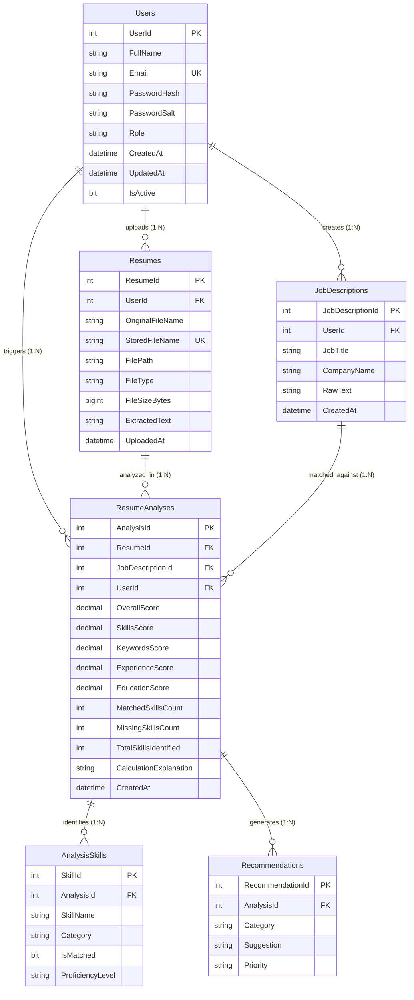

# AI Resume Analyzer

**Academic Submission – B.Tech Computer Engineering, Semester 5**  
**Course:** .NET Technologies | **Platform:** ASP.NET Core MVC (.NET 8.0 LTS · Visual Studio 2022) & Microsoft SQL Server

---

## 1. Project Overview & Problem Statement

In contemporary recruitment pipelines, job seekers frequently submit resumes without knowing whether their credentials align with Applicant Tracking System (ATS) screening criteria. Many students and candidates are filtered out due to missing keywords, non-standard document formatting, or lack of explicit competency terms.

**AI Resume Analyzer** is an academic capstone web application designed to benchmark resumes against job specifications. It accepts resumes in PDF (`.pdf`) and Microsoft Word (`.docx`) formats, parses technical competencies and lexical n-grams, compares them against target job postings, and computes a **transparent, explainable 4-pillar compatibility score** accompanied by prioritized, actionable improvement recommendations and printable evaluation reports.

---

## 2. Key Features

### Candidate Features
- **Account Management & Authentication:** Secure registration and login using PBKDF2 SHA-256 password hashing with cryptographic salt, secure session cookies, and profile management.
- **Secure Resume Upload & Extraction:** Drag-and-drop document upload with binary magic byte signature verification, file size limits (5 MB), and GUID storage outside web roots. Pure .NET text extraction using `PdfPig` (PDF) and `DocumentFormat.OpenXml` (DOCX).
- **Intelligent 4-Pillar Scoring Engine:** Explainable evaluation across:
  - Technical Skills Match (40% Weight)
  - Lexical Keyword Overlap (25% Weight)
  - Relevant Experience Context (20% Weight)
  - Education & Qualifications (15% Weight)
- **Visual Analysis Reports:** Circular score gauges, progress meters, matched competency chips, missing gap badges, and actionable guidance categorized by priority (High, Medium, Low).
- **Printable Evaluation Dossier:** Formal, printable PDF report view for candidate portfolios and academic reviews.
- **Historical Tracking & Search:** Searchable analysis history log tracking past evaluations over time.

### Administrator Features
- **Role-Based Access Control (RBAC):** Custom `[AdminAuthorize]` action filter restricting administrative functions to verified administrators.
- **Live SQL Telemetry Dashboard:** Aggregates real-time statistics directly from SQL Server (Total registered candidates, stored documents, analyses executed, platform average match).
- **User Account Management:** Administrative directory allowing promotion/demotion of user roles and activation/deactivation of candidate accounts with self-protection guardrails.

---

## 3. Technology Stack & Constraints Adherence

In strict accordance with the academic syllabus constraints:

| Component | Technology | Rationale & Configuration |
| :--- | :--- | :--- |
| **Language** | **C# 12 / .NET 8.0 LTS** | Primary language; Visual Studio 2022 compatible; strong-named signed assemblies; zero non-.NET backend runtimes. |
| **Web Framework** | **ASP.NET Core MVC** | Model-View-Controller pattern, Razor Views, Partial Views, Tag Helpers, and Model Validation. |
| **Database Engine** | **Microsoft SQL Server 2025** | LocalDB instance `(localdb)\MSSQLLocalDB`; 3NF normalized schema. |
| **Data Access** | **Pure ADO.NET** | `SqlConnection`, `SqlCommand`, `SqlDataReader`, `SqlDataAdapter`, `DataSet`, `DataTable`, `SqlTransaction`. **Strictly NO Entity Framework Core as primary ORM.** |
| **Authentication** | **Session & PBKDF2 Hashing** | ASP.NET Core Session state, 100,000 iterations PBKDF2 SHA-256 with 128-bit salt. |
| **Document Processing** | **PdfPig & OpenXml** | Pure .NET libraries (`UglyToad.PdfPig` and `DocumentFormat.OpenXml`); no Python or external Node.js wrappers. |
| **Testing** | **xUnit Test Framework** | 21 passing automated unit and integration tests covering security, extraction, and scoring algorithms. |
| **Styling & UI** | **Bootstrap 5.3 + Custom CSS** | Responsive SaaS design system, Inter typography, clean dashboard cards, progress meters, and print media styling. |

---

## 4. System Architecture & Layered Design

```mermaid
flowchart TD
    subgraph Presentation_Layer ["Presentation Layer (Razor & REST API)"]
        Landing["Landing Page (Home/Index)"]
        AuthViews["Account Views (Login, Register, Profile)"]
        UserDash["User Dashboard (Dashboard/Index)"]
        ResumeViews["Resume Views (Upload, MyResumes, Details)"]
        AnalysisViews["Analysis Views (Create, Result, History, PrintReport)"]
        AdminViews["Admin Center (Dashboard, Users)"]
        RestApi["REST Web API Controllers (/api/resumes, /api/analyses, /api/users)"]
    end

    subgraph Security_Filters ["Security & Pipeline Middleware"]
        SecHeaders["SecurityHeadersMiddleware"]
        GlobalEx["ExceptionHandlingMiddleware"]
        SessionAuth["[SessionAuthorize] Filter"]
        AdminAuth["[AdminAuthorize] Filter"]
        AntiCSRF["[ValidateAntiForgeryToken]"]
    end

    subgraph Business_Services ["Service Layer (Business Logic)"]
        PasswordService["PasswordHasher (PBKDF2 SHA-256)"]
        ExtractService["ResumeTextExtractor (PdfPig + OpenXML)"]
        ScoringEngine["ResumeAnalysisService (Weighted Scoring & Taxonomy)"]
    end

    subgraph Data_Access ["Data Access Layer (Pure ADO.NET Repositories)"]
        DbFactory["DbConnectionFactory (SqlConnection)"]
        UserRepo["UserRepository (SqlCommand, SqlDataReader)"]
        ResumeRepo["ResumeRepository (SqlDataAdapter, DataSet, DataTable)"]
        AnalysisRepo["AnalysisRepository (SqlTransaction, Multi-table atomic commit)"]
        AdminRepo["AdminRepository (SQL Server Aggregations)"]
    end

    subgraph Storage ["Persistent Storage"]
        SqlDatabase[("Microsoft SQL Server\nAIResumeAnalyzerDB")]
        AppFiles["App_Data/Resumes\n(Secure Non-Static Storage)"]
    end

    Presentation_Layer --> Security_Filters
    Security_Filters --> Business_Services
    Business_Services --> Data_Access
    Data_Access --> Storage
```



---

## 5. Database Schema (Normalized 3NF)

The database `AIResumeAnalyzerDB` consists of six normalized relational tables:



---

## 6. Scoring Algorithm & Explainability Formula

The `ResumeAnalysisService` implements a weighted, multi-factor scoring algorithm:

$$\text{Overall Score} = (0.40 \times \text{Skills}) + (0.25 \times \text{Keywords}) + (0.20 \times \text{Experience}) + (0.15 \times \text{Education})$$

1. **Technical Skills Match (40% Weight):**  
   Evaluates presence of target skills from our structured technical dictionary across 6 domains (Programming Languages, Web & Frameworks, Databases & ORM, Architecture & Design Patterns, Core Computer Science, and DevOps/Tools).  
   Formula: $\frac{|S_{\text{Resume}} \cap S_{\text{JD}}|}{|S_{\text{JD}}|} \times 100$.

2. **Lexical Keyword Overlap (25% Weight):**  
   Filters natural language English stop-words and evaluates lexical n-gram similarity across remaining domain terms.

3. **Relevant Experience Alignment (20% Weight):**  
   Evaluates engineering action verbs (*developed, engineered, architected, implemented, maintained*) and project scope markers.

4. **Education & Qualifications (15% Weight):**  
   Detects accredited degree markers (*B.Tech, B.E., B.Sc, M.Tech, MCA*) and foundational coursework.

5. **Transparency Guarantee:**  
   Every result displays the exact formula and weights used and explicitly notes that the score is an academic benchmark rather than a proprietary ATS vendor guarantee.

---

## 7. Two-Student Academic Development Roles

| Module | Student 1: Backend & Data Architect | Student 2: UI/UX & Analysis Engineer |
| :--- | :--- | :--- |
| **Database & ADO.NET** | Normalized 3NF DDL (`Schema.sql`), Seed script (`SeedData.sql`), `DbConnectionFactory`, `UserRepository`, `ResumeRepository` (Disconnected `DataSet`/`DataTable`), and `AnalysisRepository` (`SqlTransaction`). | Domain models (`User`, `Resume`, `ResumeAnalysis`, `AnalysisSkill`, `Recommendation`), ViewModels, and test specifications. |
| **Authentication & Security** | PBKDF2 SHA-256 hasher with salt, Session authentication filters (`[SessionAuthorize]`, `[AdminAuthorize]`), Security headers middleware, and exception handling. | Auth Razor Views (`Login.cshtml`, `Register.cshtml`, `Profile.cshtml`, `AccessDenied.cshtml`), client-side unobtrusive validations. |
| **Document Processing & Engine** | Upload controller, GUID storage in `App_Data/Resumes/`, binary magic byte signature verification, and text extraction service. | `ResumeAnalysisService` 4-pillar algorithm, technical taxonomy regex dictionary, and recommendation generator. |
| **UI & Visualizations** | Admin telemetry SQL aggregation queries, Admin controller, REST API endpoints (`/api/resumes`, `/api/analyses`, `/api/users`). | Modern SaaS theme (`site.css`), User Dashboard, Analysis Create view with demo loaders, Result gauge view, and printable PDF report. |
| **Testing & Quality Assurance** | Database integration test suite (`DatabaseIntegrationTests.cs`), Strong-name key signing configuration (`key.snk`). | Scoring algorithm tests (`AnalysisEngineTests.cs`), signature validation tests (`TextExtractorTests.cs`), and documentation. |

---

## 8. Installation & Setup Guide

### Prerequisites
- Windows 10 / 11 (x64)
- [.NET 8.0 LTS / .NET 9.0 SDK](https://dotnet.microsoft.com/) with Visual Studio 2022
- Microsoft SQL Server or SQL Server LocalDB (`(localdb)\MSSQLLocalDB`)
- Git

### Step 1: Clone Repository
```powershell
git clone <repository-url>
cd "c:\Users\mihir\source\repos\.NET PROJECT 2026"
```

### Step 2: Initialize Database
Start LocalDB and execute the schema and seed scripts using `sqlcmd`:
```powershell
sqllocaldb start MSSQLLocalDB
sqlcmd -S "(localdb)\MSSQLLocalDB" -i "src/AIResumeAnalyzer/Database/Schema.sql"
sqlcmd -S "(localdb)\MSSQLLocalDB" -i "src/AIResumeAnalyzer/Database/SeedData.sql"
```

### Step 3: Verify Connection String
Verify `src/AIResumeAnalyzer/appsettings.json`:
```json
{
  "ConnectionStrings": {
    "DefaultConnection": "Server=(localdb)\\MSSQLLocalDB;Database=AIResumeAnalyzerDB;Trusted_Connection=True;MultipleActiveResultSets=true;TrustServerCertificate=True;"
  }
}
```

### Step 4: Run the Application
```powershell
dotnet run --project src/AIResumeAnalyzer/AIResumeAnalyzer.csproj --launch-profile http
```
Open your browser and navigate to: **`http://localhost:5095`**

### Step 5: Execute Automated Test Suite
Run the 21 automated unit and integration tests:
```powershell
dotnet test tests/AIResumeAnalyzer.Tests/AIResumeAnalyzer.Tests.csproj
```

---

## 9. Faculty Evaluation & Demo Credentials

For quick evaluation during project demonstration, pre-seeded accounts with sample data are available:

| Role | Email Address | Password | Pre-loaded Capabilities |
| :--- | :--- | :--- | :--- |
| **Candidate Student** | `student@college.edu` | `Student@123` | Pre-loaded with `Alex_Johnson_Resume.pdf`, 1 completed analysis against a .NET Backend job description, and dashboard history. |
| **System Administrator**| `admin@airesume.local` | `Admin@123` | Full access to Admin Center (`/Admin/Dashboard`), user directory, role control, and system telemetry. |

> [!TIP]
> The Login page (`/Account/Login`) features **"Faculty Evaluation Demo Fill"** buttons that auto-populate either account's credentials with one click.

---

## 10. REST API Documentation

All API endpoints return standard structured JSON envelopes:
`{ "success": true, "message": "...", "data": { ... }, "errors": [] }`

| Method | Endpoint | Description | Requires Auth |
| :--- | :--- | :--- | :--- |
| `GET` | `/api/resumes` | Retrieves all uploaded resumes for the signed-in user | Yes (Session) |
| `GET` | `/api/resumes/{id}` | Retrieves metadata and extracted text for a specific resume | Yes (Session) |
| `POST` | `/api/resumes/upload` | Multipart form upload of a `.pdf` or `.docx` resume | Yes (Session) |
| `GET` | `/api/analyses` | Retrieves all historical analyses for the signed-in user | Yes (Session) |
| `GET` | `/api/analyses/{id}` | Retrieves detailed analysis with matched/missing skills | Yes (Session) |
| `POST` | `/api/analyses` | Executes a new analysis on a stored resume against a job description | Yes (Session) |
| `GET` | `/api/users/profile` | Retrieves current user profile details (sanitized) | Yes (Session) |
| `GET` | `/api/users/stats` | Retrieves aggregate metrics (total resumes, average score, max score) | Yes (Session) |

---

## 11. Security Implementation Highlights

1. **SQL Injection Immunity:** All database calls in `UserRepository`, `ResumeRepository`, `AnalysisRepository`, and `AdminRepository` utilize explicit `SqlParameter` objects with strict SQL data types (`SqlDbType.NVarChar`, `SqlDbType.Int`, `SqlDbType.Decimal`). No user input is ever concatenated into SQL query strings.
2. **Cryptographic Password Storage:** Passwords are never stored in plain text. PBKDF2 SHA-256 with 100,000 iterations and unique 128-bit cryptographic salts per user is implemented in `PasswordHasher.cs`.
3. **Execution Prevention & Secure Uploads:** Uploaded documents are inspected for binary magic byte signatures (`%PDF` for PDFs and `PK\x03\x04` for Word documents) to reject disguised executables. Files are assigned non-predictable GUID names and stored in `App_Data/Resumes/` outside the web root (`wwwroot`), preventing direct HTTP access.
4. **Anti-CSRF & Safe Error Handling:** All MVC form submissions are protected via `@Html.AntiForgeryToken()`. Unhandled exceptions are intercepted by `ExceptionHandlingMiddleware` without exposing stack traces to end users.
5. **Security Headers:** Injected on all HTTP responses: `X-Content-Type-Options: nosniff`, `X-Frame-Options: SAMEORIGIN`, `X-XSS-Protection: 1; mode=block`, and `Referrer-Policy: strict-origin-when-cross-origin`.

---

## 12. Limitations & Future Scope

### Current Limitations
- Scanned PDF resumes consisting purely of rasterized images require Optical Character Recognition (OCR), which is outside the pure .NET library scope.
- Scoring is heuristic and taxonomy-based rather than utilizing a large language model.

### Future Enhancements
- Integration of ML.NET binary classification to train custom models on labeled resume datasets.
- Multilingual resume parsing for international job descriptions.
- Automated email notification upon completion of batch resume analyses.

---

## 13. License & Academic Disclaimer

Developed solely for academic examination purposes for Semester 5 B.Tech Computer Engineering. All algorithms, database schemas, and codebase assets are designed for educational demonstration.
